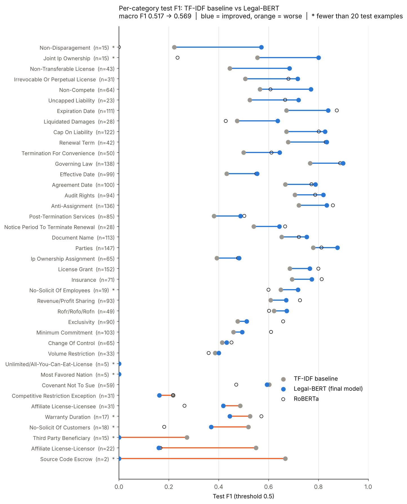

# Accenture Contract Review Challenge: Clause Detection and Risk Triage on CUAD

> 💡 **Note for the team:** This is just a template. Update the above title with your AI Studio Challenge Project name. Remove all guidance notes and example text in this template and populate this README with your own content. You can work on this README throughout AI Studio, and get feedback from your AI Studio Coach and Challenge Advisor before finalizing it.  

---

### 👥 **Team Members**

| Name                | GitHub Handle | Contribution                                                             |
|---------------------|---------------|--------------------------------------------------------------------------|
| Erin Sur            | @erinsur      | Data exploration, visualization, overall project coordination            |
| Aarabhi Kuchi       | @jramirez     | Data collection, exploratory data analysis (EDA), dataset documentation  |
| Jeslyn Chang        | @aminahassan  | Data preprocessing, feature engineering, data validation                 |
| Christian De Guzman | @pmehta       | Model selection, hyperparameter tuning, model training and optimization  |
| Dzifa Thomas        | @chrispark    | Model evaluation, performance analysis, results interpretation           |
| Safina Thapa        | @safinathapa  | Data cleaning, preprocessing, and data validation                        |
| Jackie Perales      | @jperal246    | Text-to-numbers features, baseline vs. transformer comparison, results write-up |
| Avigya (Avi) Paudel | @avi161       | Model evaluation, training, optimization, exploratory data analysis (EDA)|
---

## 🎯 **Project Highlights**

- Built a chunk-based, multi-label clause classifier for the 41 CUAD clause categories: contracts are split into overlapping 512-token chunks and each chunk gets 41 yes/no labels.
- Established a TF-IDF + one-vs-rest logistic regression baseline (test micro F1 0.591, macro F1 0.517) and fine-tuned two transformer encoders, `roberta-base` and `nlpaueb/legal-bert-base-uncased`.
- **Legal-BERT is the final model: test micro F1 0.703 and macro F1 0.569**, beating the baseline in 28 of the 40 measurable categories, with eight categories now at F1 ≥ 0.80 (Governing Law, Parties, Expiration Date, Anti-Assignment, Renewal Term, Cap On Liability, Audit Rights, Joint IP Ownership).
- Identified the main remaining gap: the transformer is far more precise than the baseline but under-predicts rare clauses (recall 0 on four categories at a 0.5 threshold). Per-category threshold tuning and class weighting are the next step before the risk-scoring layer in November.

---

## 👩🏽‍💻 **Setup and Installation**

**Provide step-by-step instructions so someone else can run your code and reproduce your results. Depending on your setup, include:**

* How to clone the repository
* How to install dependencies
* How to set up the environment
* How to access the dataset(s)
* How to run the notebook or scripts

---

## 🏗️ **Project Overview**

**Describe:**

- How this project is connected to the Break Through Tech AI Program
- Your AI Studio host company and the project objective and scope
- The real-world significance of the problem and the potential impact of your work

---

## 📊 **Data Exploration**

**You might consider describing the following (as applicable):**

* The dataset(s) used: origin, format, size, type of data
* Data exploration and preprocessing approaches
* Insights from your Exploratory Data Analysis (EDA)
* Challenges and assumptions when working with the dataset(s)

**Potential visualizations to include:**

* Plots, charts, heatmaps, feature visualizations, sample dataset images

---

## 🧠 **Model Development**

**You might consider describing the following (as applicable):**

* Model(s) used (e.g., CNN with transfer learning, regression models)
* Feature selection and Hyperparameter tuning strategies
* Training setup (e.g., % of data for training/validation, evaluation metric, baseline performance)

---

## 📈 **Results & Key Findings**

*Source: [`notebooks/Baseline_vs_Transformer_Comparison.ipynb`](notebooks/Baseline_vs_Transformer_Comparison.ipynb). Full tables are in [`results/comparison/`](results/comparison/).*

All models are scored on the same 2,898 test chunks (102 held-out contracts) with a fixed 0.5 decision threshold. Price Restrictions has no positive test chunks, so it is excluded from the averages and 40 categories are measured. Micro F1 pools every decision (dominated by common clauses); macro F1 averages the categories equally (fair to rare clauses). The test set was used once, for these numbers only.

### Overall

| Model | Precision (micro) | Recall (micro) | **Micro F1** | **Macro F1** |
|---|---:|---:|---:|---:|
| TF-IDF + logistic regression (baseline) | 0.519 | 0.686 | 0.591 | 0.517 |
| RoBERTa (`roberta-base`), 15 epochs | 0.756 | 0.638 | 0.692 | 0.524 |
| **Legal-BERT (`nlpaueb/legal-bert-base-uncased`), 15 epochs** | 0.774 | 0.643 | **0.703** | **0.569** |

Fine-tuning a transformer clearly beats the bag-of-words baseline: +0.11 micro F1 and +0.05 macro F1 for Legal-BERT. Legal-BERT, pre-trained on legal text, also beats RoBERTa in 23 of 40 categories and was selected on the validation set (macro average precision 0.593 vs 0.542), so it is the final model.

### Per-category comparison: baseline vs. transformers

Legal-BERT vs. the baseline, over the 40 measurable categories: **28 improved, 5 about the same, 7 got worse** (a change of more than 0.02 F1 counts as a real change; the run-to-run noise is about ±0.01). Sorted by the size of the change. `\*` marks categories with fewer than 20 positive test chunks, where one chunk more or less moves the score a lot.

| Category | Test chunks | TF-IDF F1 | RoBERTa F1 | Legal-BERT F1 | Change (Legal-BERT vs TF-IDF) | Result |
|---|---:|---:|---:|---:|---:|---|
| Non-Disparagement \* | 15 | 0.22 | 0.00 | 0.57 | +0.35 | improved |
| Joint Ip Ownership \* | 15 | 0.56 | 0.24 | 0.80 | +0.24 | improved |
| Non-Transferable License | 43 | 0.44 | 0.68 | 0.68 | +0.24 | improved |
| Irrevocable Or Perpetual License | 31 | 0.51 | 0.68 | 0.72 | +0.21 | improved |
| Non-Compete | 64 | 0.57 | 0.61 | 0.77 | +0.21 | improved |
| Uncapped Liability | 23 | 0.53 | 0.67 | 0.72 | +0.19 | improved |
| Expiration Date | 111 | 0.67 | 0.87 | 0.84 | +0.17 | improved |
| Liquidated Damages | 28 | 0.47 | 0.43 | 0.64 | +0.16 | improved |
| Cap On Liability | 122 | 0.67 | 0.80 | 0.83 | +0.16 | improved |
| Renewal Term | 42 | 0.68 | 0.83 | 0.83 | +0.15 | improved |
| Termination For Convenience | 50 | 0.50 | 0.61 | 0.64 | +0.14 | improved |
| Governing Law | 138 | 0.77 | 0.89 | 0.90 | +0.13 | improved |
| Effective Date | 99 | 0.43 | 0.55 | 0.55 | +0.12 | improved |
| Agreement Date | 100 | 0.67 | 0.77 | 0.79 | +0.12 | improved |
| Audit Rights | 94 | 0.71 | 0.79 | 0.82 | +0.11 | improved |
| Anti-Assignment | 136 | 0.72 | 0.86 | 0.83 | +0.11 | improved |
| Post-Termination Services | 85 | 0.38 | 0.50 | 0.49 | +0.11 | improved |
| Notice Period To Terminate Renewal | 28 | 0.54 | 0.67 | 0.64 | +0.10 | improved |
| Document Name | 113 | 0.65 | 0.72 | 0.75 | +0.10 | improved |
| Parties | 147 | 0.78 | 0.81 | 0.88 | +0.10 | improved |
| Ip Ownership Assignment | 65 | 0.39 | 0.48 | 0.48 | +0.09 | improved |
| License Grant | 152 | 0.68 | 0.80 | 0.77 | +0.08 | improved |
| Insurance | 71 | 0.69 | 0.81 | 0.77 | +0.08 | improved |
| No-Solicit Of Employees \* | 19 | 0.65 | 0.60 | 0.72 | +0.07 | improved |
| Revenue/Profit Sharing | 93 | 0.61 | 0.73 | 0.67 | +0.06 | improved |
| Rofr/Rofo/Rofn | 49 | 0.62 | 0.60 | 0.67 | +0.05 | improved |
| Exclusivity | 90 | 0.48 | 0.66 | 0.51 | +0.04 | improved |
| Minimum Commitment | 103 | 0.46 | 0.61 | 0.49 | +0.04 | improved |
| Change Of Control | 65 | 0.41 | 0.45 | 0.43 | +0.02 | about the same |
| Volume Restriction | 33 | 0.39 | 0.36 | 0.40 | +0.01 | about the same |
| Most Favored Nation \* | 5 | 0.00 | 0.00 | 0.00 | +0.00 | about the same |
| Unlimited/All-You-Can-Eat-License \* | 5 | 0.00 | 0.00 | 0.00 | +0.00 | about the same |
| Covenant Not To Sue | 59 | 0.60 | 0.47 | 0.59 | -0.01 | about the same |
| Competitive Restriction Exception | 31 | 0.22 | 0.22 | 0.16 | -0.06 | got worse |
| Affiliate License-Licensee | 31 | 0.49 | 0.26 | 0.42 | -0.07 | got worse |
| Warranty Duration \* | 17 | 0.53 | 0.57 | 0.44 | -0.08 | got worse |
| No-Solicit Of Customers \* | 18 | 0.52 | 0.18 | 0.37 | -0.15 | got worse |
| Third Party Beneficiary \* | 15 | 0.27 | 0.00 | 0.00 | -0.27 | got worse |
| Affiliate License-Licensor | 22 | 0.55 | 0.17 | 0.16 | -0.39 | got worse |
| Source Code Escrow \* | 2 | 0.67 | 0.00 | 0.00 | -0.67 | got worse |
| Price Restrictions | 0 | – | – | – | – | not measurable |

### Key findings

**1. The transformer helps most where meaning depends on context, not keywords.** The largest gains are clauses that the baseline confused with neighbouring clause types: Non-Disparagement (0.22 → 0.57), Joint IP Ownership (0.56 → 0.80), Non-Transferable License (0.44 → 0.68), Irrevocable Or Perpetual License (0.51 → 0.72), Non-Compete (0.57 → 0.77), Uncapped Liability (0.53 → 0.72) and Liquidated Damages (0.47 → 0.64). A bag of words sees *license* and *transfer* in both a License Grant and a Non-Transferable License; the transformer reads the sentence.

**2. The core clauses become reliable.** Governing Law 0.90, Parties 0.88, Expiration Date 0.84, Anti-Assignment 0.83, Renewal Term 0.83, Cap On Liability 0.83, Audit Rights 0.82. The baseline had no category at F1 ≥ 0.80; Legal-BERT has eight.

**3. The hard common categories are still hard.** Post-Termination Services, IP Ownership Assignment, Change Of Control, Minimum Commitment, Exclusivity, Effective Date and Volume Restriction all improve but stay between F1 0.40 and 0.55. They share vocabulary with other clauses (*termination*, *exclusive*, *date*). The number of weak categories (F1 < 0.5) only falls from 15 to 14. RoBERTa is noticeably better than Legal-BERT on two of these, Exclusivity (0.66 vs 0.51) and Minimum Commitment (0.61 vs 0.49), so the two models have different strengths.

**4. Rare categories got worse.** All seven categories that declined have fewer than 125 training chunks, and most have fewer than 20 test chunks: Source Code Escrow (0.67 → 0.00, but only 2 test chunks), Affiliate License-Licensor (0.55 → 0.16), Third Party Beneficiary (0.27 → 0.00), No-Solicit Of Customers (0.52 → 0.37), Warranty Duration, Affiliate License-Licensee and Competitive Restriction Exception. Four categories are never predicted at all on the test set at the 0.5 threshold: Most Favored Nation, Unlimited/All-You-Can-Eat-License, Third Party Beneficiary and Source Code Escrow.

**5. Why: precision went up, recall went down.** Legal-BERT has higher precision than the baseline in 33 of 40 categories, but higher recall in only 10. It flags 2,017 chunk-category pairs on the test set versus 3,208 for the baseline (2,429 are truly positive), so it under-predicts. The baseline's `class_weight='balanced'` forced it to say "yes" often (high recall, many false alarms); the transformers were trained with no class weights and a fixed 0.5 threshold, so their probabilities for rare clauses rarely cross 0.5. For contract risk review a missed clause costs more than a false alarm, so recall matters more. This makes per-category threshold tuning and class weighting (Milestone 2, Task #3) the most important next step: lowering the threshold for rare categories should recover much of the lost recall while keeping most of the precision gain.

**Caveats.** Scores are per chunk, not per contract. Each model was trained once with one seed. The baseline trained on all 408 training contracts while the transformers trained on 347 (61 were held out for validation), which slightly favors the baseline. Categories with very few test examples have unreliable scores, and Price Restrictions cannot be evaluated on this test set.

---

## 🚀 **Next Steps**

- **Per-category thresholds and class imbalance (Task #3).** Tune the decision threshold per category on the validation set instead of 0.5, and test `pos_weight` in the loss and oversampling of rare categories. This targets the recall loss on rare clauses described above.
- **Final per-category evaluation and error analysis (Tasks #4 and #5).** Re-score the tuned model on the test set, and inspect false positives and false negatives for the 13 rare categories to find patterns in the mistakes.
- **Contract-level scores.** Roll chunk predictions up to the contract level (a clause split across two chunks currently counts twice), which is also what the risk-scoring layer needs.
- **Rare categories.** More training signal is needed for Most Favored Nation, Unlimited License, Third Party Beneficiary, Source Code Escrow and Price Restrictions: data augmentation, combining RoBERTa and Legal-BERT (they have different strengths), or reporting these categories with confidence intervals.
- **November milestone.** Build and calibrate the rule-based four-signal risk-scoring layer, assemble the end-to-end pipeline, and validate the risk rankings against the advisor's hand-ranked clauses (Spearman correlation and bucket agreement).

---

## 📝 **License**

Specify how your project can be used by others. Choose an appropriate license and link it here (e.g., MIT, Apache 2.0). Make sure your Challenge Advisor approves of the selected license type. 

**Example:**
This project is licensed under the MIT License.

---

## 📄 **References** (Optional but encouraged)

Cite relevant papers, articles, or resources that supported your project.

---

## 🙏 **Acknowledgements** (Optional but encouraged)

Thank your Challenge Advisor, host company representatives, TA, and others who supported your project.
